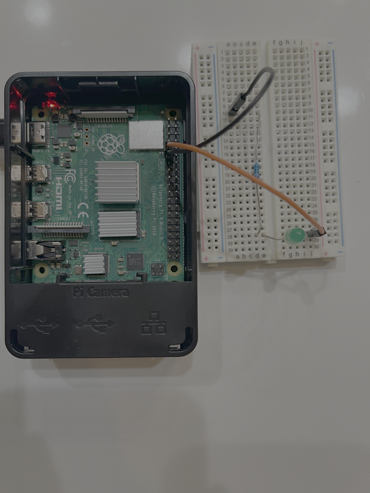

# LED_Project

My first embedded systems project, built to develop my skills in C programming, GPIO control, and breadboard prototyping using a Raspberry Pi.

The goal of this project is to control an LED through software, exploring the fundamentals of embedded development and hardware interaction.

## Hardware Setup

The circuit uses a Raspberry Pi connected to an LED circuit on a breadboard.




## Components

- Raspberry Pi
- Breadboard
- LED
- Current-limiting resistor
- Jumper wires

## What I Learned

- Introduction to C programming for hardware projects
- Basic GPIO control
- Connecting electronic components on a breadboard
- Understanding how software interacts with physical hardware

## Project Structure

```text
LED_Project/
└── 01-Blink/
    ├── IMG_8669.png
    ├── blink.c
    └── blink_v1.1.c
    


