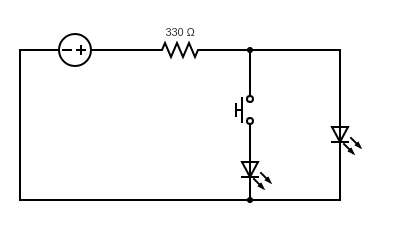
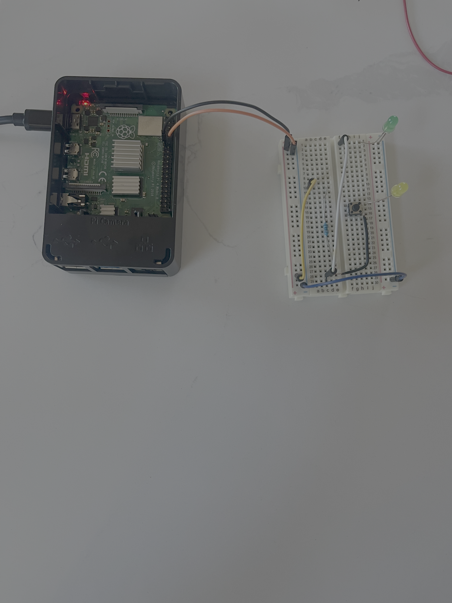

# LED_Project

*Description: This is a version two which builds off of version one, much more simplified, rather than blinking the LED on and off, this turns the LED on for ten seconds so that the user can blink the second LED on and off. This version serves to help me better understand concepts like parallel circuits and ohms law in a practical sense.*

**Bellow is a circuit Diagram for the bread board built:**

**Bellow is an image of the Raspberry Pi and Bread Board set up:**

